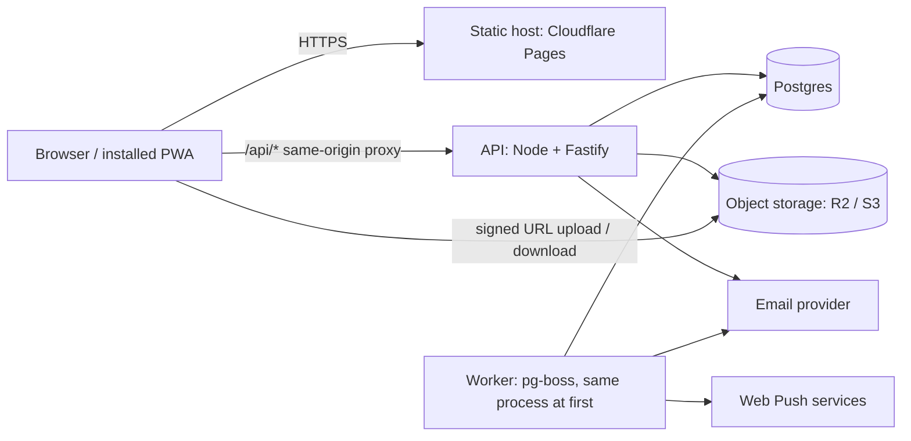
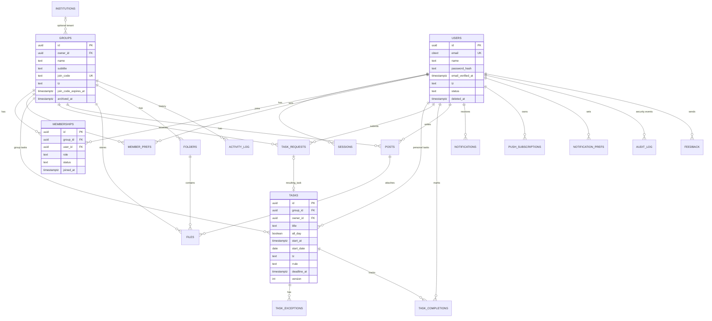

# Groupy: Architecture, Security & Build Plan ([PLAN.md](http://PLAN.md))

> Self-contained. A human mentor-style plan **and** an instruction file for an AI IDE. Date written: 2026-11-06. Free-tier limits and library versions change: **verify on each vendor's pricing/docs page before committing.**

---

## 0. How to use this document

**For you (the learner):** go phase by phase. Each phase is a loop: *learn (study list) → design (write a decision in* `docs/decisions/`*) → let AI write code → review with Section 15 → test → done-criterion.* Do not let AI code ahead of your understanding of the phase.

**Build order (REQUIRED READ FIRST):** this file is the *why*; `SECTIONS.md` (same folder) is the *order*. Work strictly section by section (S0 → S10): read the PLAN.md parts listed there → take notes → tell the AI to implement exactly one section → review → **freeze** its contract so later sections can never break earlier ones. Any TS in this plan is translated to Django/DRF per the table in `SECTIONS.md` §0.

**For the AI IDE: rules (put a copy in** `AGENTS.md` **/** `.cursorrules` **/** `CLAUDE.md`**):**

 1. Work only on the current **SECTIONS.md section (S)** / slice step the user names. Read that section + the referenced parts of this file first. Never modify an item on a previous section's **Frozen** list without an approved change request.
 2. **Never change the UI's look or layout.** Front-end work is *wiring only* (API calls, state, loading/error states). New screens are allowed only if listed in Section 3.3 and approved by the user.
 3. Layering: `route (HTTP only) → service (business rules, transactions) → repository (SQL only)`. No SQL in routes. No business rules in React.
 4. **Deny by default.** Every read/write of group data goes through the policy module (`can(actor, action, resource)`). Non-members get **404**, not 403 (don't leak existence).
 5. Validate every input with strict Zod schemas. Return explicit response DTOs; **never return raw DB rows** (prevents leaking `password_hash` etc.).
 6. Parameterized queries only. No string-built SQL, ever.
 7. Never log passwords, OTPs, tokens, cookies, full emails. Redact in the logger config.
 8. Time: store `timestamptz` in UTC; all-day events use `date`. Never store local times without an IANA zone.
 9. Schema changes only via migration files. Ask the user before changing the data model in Section 5.
10. Every endpoint ships with tests: happy path, validation failure, **cross-group/cross-user access denied**, and rate limit if relevant.
11. Mark security-relevant code with `// SECURITY:` and a one-line reason.
12. New dependency? Justify it in the PR description, pin the version, run the audit.
13. Small commits, Conventional Commit messages, PR checklist = Section 15.
14. If a requirement is ambiguous or a rule isn't in this file, **stop and ask**; don't invent security behaviour.

---

## 1. Assumptions and open questions

### Assumptions (change any by telling me)

| \# | Assumption |
| --- | --- |
| A1 | Solo developer, \~8–10 h/week, student budget (≈$0/month + maybe a \~$10/yr domain). |
| A2 | First users are in Pakistan (default tz `Asia/Karachi`, no DST today) but the design is **tz-safe for any zone**. |
| A3 | Scale for MVP: ≤ 300 members per group, hundreds of groups, low thousands of users. One server + one Postgres is plenty. |
| A4 | Language: English only. Users are 18+ university students (age gate in Terms; confirm). |
| A5 | **DECIDED 2026-11-07:** Backend = **Python (Django + DRF + PostgreSQL)** — you don't write backend JS/TS. Front end stays React/TS unchanged. Architecture, data model, rules and tests in this plan stay identical; TS snippets map to Python via the table in `SECTIONS.md` §0. Contract-first is kept via `drf-spectacular` → `openapi.json` → generated TS client types. |
| A6 | **MVP excludes:** chat, folders, join-approval workflow, malware scanning (we restrict file types instead), billing, SMS, multi-institution UI. Tables for some are designed now so we don't repaint later. |
| A7 | Email-OTP only (no SMS: cost and SIM-swap risk). |
| A8 | Cross-device sign-in is via the same email+password (+OTP on new device). |

### Open questions (answer when you can; defaults in brackets)

 1. **Hosting payment:** do you have an international card (Visa/Mastercard) for hosting/email/domain signups? \[No → use the "no card" hosting path in 2.3\]
 2. **Domain:** can you buy a cheap domain (\~$10/yr)? It matters for cookies, email deliverability and the proxy design. \[Yes\]
 3. **Chat:** is chat a real feature or only notifications of type "message"? \[Not in MVP; announcements cover it\]
 4. **Joining:** keep "enter code → instantly a member" for MVP, with approval as an optional per-group setting later? \[Yes\]
 5. **Login OTP:** the UI shows an OTP step on login too. OK to require OTP **only on sign-up and on new/untrusted devices** (saves email quota, better UX)? \[Yes\]
 6. **Co-admins:** allow several admins per group (CR + deputy CR)? \[Yes; plus a single "owner"\]
 7. **Who uploads files:** admins only in MVP? \[Yes\]
 8. **University email gating:** restrict sign-up to e.g. `@nu.edu.pk`? \[No for MVP; `institutions` table reserved\]
 9. **Display names:** the sign-up form has only email+password. Where does the name come from? \[Derive from email, edit in Settings → Profile\]
10. **Forgot password / delete group / leave group / remove member** have no screens in Section B of your brief. May I add these minimal screens? \[Yes, see 3.3\]

---

## 2. Architecture recommendation

### 2.1 Style: modular monolith

One deployable API (Node) organised in modules (`auth`, `groups`, `tasks`, `files`, `notifications`), one Postgres, one static front end. **Why:** a solo dev cannot operate microservices; modules with clear boundaries keep the option to split later. **Alternatives:** microservices (operational overhead), serverless functions per route (cold starts, connection limits, hard to debug). **Study:** "modular monolith", "hexagonal / ports and adapters", "The Twelve-Factor App".



### 2.2 Stack, with why / alternatives / study

| Layer | Choice | Why | Alternatives | Study |
| --- | --- | --- | --- | --- |
| Language | TypeScript (strict) | One language; **Zod schemas shared** between client and server = contract-first | Python/Django+DRF, Go | TS strict mode, "type narrowing" |
| API framework | **Fastify** + `fastify-type-provider-zod` | Schema-first, fast, built-in pino logging, plugins | Hono (tiny, great on edge), Express (no schema story), NestJS (heavy, but structured) | Fastify docs: hooks, plugins, encapsulation |
| DB | **Postgres 16+** (Neon or Supabase *as plain Postgres*) | Relational data, constraints, transactions, range queries, RLS | Firestore (built-in offline sync, but weak relational queries, security-rules complexity, lock-in), MongoDB | Section 5.2 |
| ORM / migrations | **Drizzle ORM + drizzle-kit** (SQL-close; hand-edit SQL when needed) | You learn real SQL; partial indexes, CHECKs, RLS via raw SQL migrations | Prisma (nicer DX, awkward for RLS/partial indexes), Kysely + plain SQL migrations | "SQL migrations", "expand/contract" |
| Validation | **Zod** at every boundary | Same schema = types + runtime checks + OpenAPI | Valibot, TypeBox, Joi | Zod docs: `.strict()`, `.transform`, `.refine` |
| Auth | **Own implementation**: Argon2id + email OTP + **server-side sessions** | You learn it; no vendor lock; cheap | Supabase Auth / Clerk / Auth.js (faster, but you learn less and cost/lock-in) | OWASP Auth, Session, Password Storage cheat sheets |
| Jobs / queue | **pg-boss** (queue inside Postgres) | No Redis to host; transactional outbox friendly | BullMQ+Redis (Upstash), Cloudflare Queues | "transactional outbox pattern" |
| Files | **Cloudflare R2** (S3-compatible, no egress fees) via **presigned URLs**; MinIO locally | Files never pass through your API server | AWS S3, Supabase Storage, Backblaze B2 | "presigned URL", "S3 CORS" |
| Email | **Resend** (or Brevo); **Mailpit** locally | Free tier OTP volume; local inbox for dev | SES (cheap, more setup), Postmark | SPF, DKIM, DMARC |
| Push | `web-push` (VAPID) | Standard Web Push, no vendor | OneSignal/FCM wrappers | "Web Push VAPID", iOS limits (Sec. 11) |
| Front end (existing) | React + Vite + Tailwind + **TanStack Query** + `vite-plugin-pwa` | Query cache = offline-tolerant reads; Workbox = proper SW | SWR, RTK Query | TanStack Query: staleTime, mutations, optimistic updates |
| Dates | Luxon (or `date-fns-tz`) + `rrule` | Safe zone handling, RFC 5545 recurrence | Temporal (polyfill still maturing) | IANA tz, RFC 5545 RRULE |
| Logging / errors | pino (JSON) + **Sentry** (free tier) | Structured logs; error grouping | Better Stack, Grafana Cloud | "structured logging", "PII redaction" |
| Tests | Vitest, Supertest/`app.inject`, Testcontainers (or CI Postgres service), **Playwright**, axe, Schemathesis, k6 | Full pyramid | Jest, Cypress | Section 9 |
| CI/CD | GitHub Actions + GitHub Environments | Free for small repos | GitLab CI | Section 9 |

### 2.3 Hosting options (be honest about free tiers)

| Part | Primary | Caveat | Fallback |
| --- | --- | --- | --- |
| Front end | Cloudflare Pages (or Vercel/Netlify) | Free, generous | any static host |
| API | **Render free web service** for dev/staging (sleeps after \~15 min idle → 30–60 s cold start) | Cold start hurts OTP login UX in prod | Prod: a \~$5/mo VPS (Hetzner/DigitalOcean) with Docker + Caddy, **or** Oracle Cloud "Always Free" ARM VM (truly free, you run the OS: great ops learning; needs card verification) |
| Postgres | Neon free (branching = free staging DB; scale-to-zero) or Supabase free | Free DBs pause/limit storage; short PITR | Postgres container on the VPS + own backups |
| Object storage | R2 free tier (10 GB) | Needs card on file | Supabase Storage / Backblaze B2 |
| Email | Resend free (≈100/day) | **Needs your own verified domain** to email arbitrary users | Brevo free |
| Edge/Workers | **Avoid for the API in MVP** | Free Workers have tiny CPU limits; **Argon2 hashing won't fit** | n/a |

**Same-site cookies (important):** `*.pages.dev` and `*.onrender.com` are *different sites* (public-suffix list), so a session cookie from the API would be a blocked third-party cookie. Fix **one** of: (a) buy a domain and serve `app.groupy.xyz` + `api.groupy.xyz` (same site); or (b) proxy `/api/*` through the front-end host (Pages Functions / Vercel rewrite) so the browser sees one origin. **Recommendation: (b) now, domain + (a) or (b) later.** Same-origin also removes CORS entirely.

**"No card" path:** Render free + Neon free + email via Brevo (verify its rules) + Supabase Storage free; accept cold starts in prod until you can afford a VPS.

### 2.4 Repo layout (pnpm monorepo)

```
groupy/
  apps/web/            # existing React app (UI frozen)
  apps/api/            # Fastify API
    src/modules/{auth,groups,tasks,files,notifications,...}/{routes,service,repo,policy}.ts
    src/db/{schema.ts,migrations/}
    src/lib/{env,logger,errors,rateLimit,email,storage,time}.ts
  packages/contract/   # Zod schemas, error codes, generated openapi.json, shared types
  docs/{decisions/,threat-models/,runbooks/}
  .github/workflows/
  docker-compose.yml   # postgres, mailpit, minio
  AGENTS.md  PLAN.md
```

### 2.5 Cost control

Free tiers + **hard caps**: provider budget alerts at $1, rate limits on every public endpoint, upload quotas (10 MB/file, 500 MB/group, 20 upload intents/user/h), email quotas tracked in a counter table, log retention 7–14 days, notifications pruned after 90 days. Expected MVP cost: **$0 + \~$10/yr domain**.

---

## 3. MVP scope

### 3.1 Must / Should / Later

| Must (MVP) | Should (v1.0) | Later |
| --- | --- | --- |
| Sign-up/login/OTP/sessions, logout | Forgot/reset password | Join approval, institutions UI |
| Create/join group, people list, code rotate | Remove member, leave group, promote/demote admin, transfer ownership | Folders, per-group file quotas UI |
| Task requests → approve/decline | Task edit/delete + change notifications | Chat |
| Admin creates tasks; calendar; day view | **Recurring tasks** (RRULE) | Task assignment to individuals |
| To-do + due soon; personal tasks | Web Push; notification prefs | Email digests, ICS calendar feed |
| In-app notifications + unread badges | Posts/announcements + file upload/download | Malware scanning, search by content |
| Feedback; profile/avatar; dark mode | Account deletion + data export | Offline write queue beyond basics |

### 3.2 Slice (Phase 4) = Sign-up/OTP → create group → join by code → member requests task → admin approves → task on member's calendar → notification.

### 3.3 Minimal UI additions needed so backend rules are *reachable* (need your approval; keep them inside existing visual language)

Forgot-password link + reset flow · People tab per-member ⋮ menu (remove/promote) · Leave group (Group detail menu) · Regenerate group code (admin) · Edit/delete task (Task detail, admin) · Cancel own pending request · Compose announcement/upload file (admin) · Delete account + Export data (Settings) · Active sessions list (Settings) · Terms/Privacy checkbox on sign-up · Empty/error/loading states for every list.

---

## 4. Phase 0: Walking skeleton (≈ 1 week)

**Goal:** the smallest end-to-end thing deployed: web → API → DB → back, with CI. Deploying on day 1 removes the biggest later risk.

**Concepts to learn:** `pnpm workspaces`, `docker compose postgres`, `fastify hello world`, `12-factor config env variables`, `GitHub Actions node pnpm cache`, `conventional commits`.

**Deliverables:** monorepo layout (2.4); `docker-compose.yml` (Postgres, Mailpit, MinIO); `GET /v1/healthz` and `/v1/readyz` (checks DB); env validation with Zod (app refuses to boot on missing/invalid env); CI workflow (lint, typecheck, test, build); web calls `/api/v1/healthz` through proxy; deployed to staging.

**Checklist:** `.env.example` committed, `.env` ignored · gitleaks pre-commit · Prettier + ESLint (with `eslint-plugin-security`) · TS `strict: true` · branch protection on `main`.

**Common mistakes:** committing `.env`; building features before CI exists; skipping `readyz`; letting the frontend hardcode API URLs.

**Done when:** a push to `main` runs CI green and the staging web app shows "API: ok, DB: ok".

---

## 5. Phase 1: Data model

**Goal:** a relational schema that makes illegal states unrepresentable, supports calendar range queries, and survives time zones, deletion and growth.

**Concepts to learn:** `database normalization 3NF`, `primary key foreign key ON DELETE`, `CHECK constraint postgres`, `partial index postgres`, `use the index luke` (book/site), `EXPLAIN ANALYZE`, `postgres transactions isolation levels`, `SELECT FOR UPDATE`, `timestamptz vs timestamp`, `citext`, `uuid v7`, `soft delete pitfalls`, `expand and contract migrations`. Book: *Designing Data-Intensive Applications*, ch. 2–3, 7.

### 5.1 Decisions

| Decision | Choice | Why | Alternatives |
| --- | --- | --- | --- |
| IDs | UUID v7 (app-generated, time-sortable) | Non-enumerable-ish, good index locality, client can create IDs offline (idempotency) | bigint identity + public id; UUIDv4 (random = index bloat). *UUIDs are not secret; authz is still mandatory.* |
| Email | citext unique (or lowercased + unique) | Case-insensitive uniqueness | app-level lowercasing only (bug-prone) |
| Time | timestamptz UTC; all-day = date; each event stores IANA tz | Correct across DST/zones | local `timestamp` (ambiguous) |
| Tasks vs requests | Separate task_requests table; approval copies into tasks in one transaction | Pending data can never leak into task queries (forgetting WHERE status='approved' is a classic BOLA bug) | Single `tasks` table with `status` (less duplication, higher leak risk) |
| Personal vs group tasks | One tasks table, group_id XOR owner_id (CHECK) | One code path for recurrence/calendar | Two tables (duplicated logic) |
| Completion | task_completions(task_id, user_id, occurrence_date) | "Done" is per user for group tasks, and per occurrence for recurring ones | `done_at` on task (wrong for groups) |
| Recurrence | Store RRULE + dtstart local + tz; expand on read within the requested window; exceptions in task_exceptions | Infinite series without infinite rows | Materialize rows (storage, edit-all pain) |
| Feed (History tab) | Query = posts ∪ approved tasks ordered by time (keyset) | No duplicate "feed_items" to keep in sync | `feed_items` table (fast reads, sync complexity) |
| Unread badge | COUNT(\*) of unread notifications grouped by group_id | Simple, indexed, matches the Alerts screen | "last_read_at" cursor per group |
| Delete | Mixed (table 5.4) | Right tool per table | Soft delete everywhere (query bugs, GDPR pain) |
| Concurrency | version int on editable rows + If-Match | Offline edits and two admins editing | last-write-wins silently |

### 5.2 SQL vs NoSQL: recommendation **Postgres**

Your data is relational (users↔groups↔tasks), needs multi-row atomic operations (approve = update request + insert task + insert notifications), uniqueness/CHECK constraints, range queries (calendar), and row-level security. Firestore's one real advantage, built-in offline sync, costs you relational queries, makes security-rules logic hard to test, and locks you in. Document DBs fit when data is nested and schema-fluid; yours isn't. **Study:** "relational vs document model" (DDIA ch. 2).

### 5.3 ER diagram (Mermaid)



### 5.4 Improved model (changes to your draft are marked **▲**)

| Table | Key columns / notes |
| --- | --- |
| `users` | `id, email citext UK, name, avatar_key, password_hash, email_verified_at, tz (IANA) ▲, status (active/suspended/pending_deletion), created_at, updated_at, deleted_at`. Never `SELECT *` (hash). |
| `otp_challenges` ▲ (was `OtpCode`) | `id, email, user_id?, purpose (signup/login/reset), code_hmac, expires_at (10 min), attempts, max_attempts (5), consumed_at, resend_count, created_at, ip_hash`. **HMAC with a server secret, not bare SHA-256:** a 6-digit code has only 1M values, so a leaked plain hash is trivially reversible. Keyed HMAC + attempt limits + short expiry is the defence. |
| `sessions` | `id, user_id, token_hash (SHA-256 of 256-bit random token) UK, device_label, ip_hash, user_agent, trusted_device bool ▲, created_at, last_seen_at, idle_expires_at, absolute_expires_at, revoked_at`. |
| `institutions` | Reserved. `groups.institution_id` nullable, **no UI/logic in MVP** (YAGNI; a group already isolates data). |
| `groups` | `id, owner_id ▲, name, subtitle, join_code UK, join_code_expires_at?, join_mode (open/approval) ▲, tz ▲ (default tz for its events), institution_id?, archived_at, created_at, updated_at`. |
| `memberships` | `id, group_id, user_id, role (admin/member), status (active/left/removed/banned ▲), joined_at, left_at, removed_by`. `UNIQUE(group_id,user_id)`: **rejoin re-activates the same row** (keeps history/FKs), role resets to member; `banned` blocks code re-entry. Invariant: ≥ 1 active admin (Sec. 6.4). |
| `member_prefs` ▲ | `(group_id,user_id) PK, colour_key, hidden_in_calendar, muted, updated_at`. Separate from `memberships` because the **user** edits it (frequent writes) while `memberships` is authz-critical. |
| `join_requests` (v1.1) | `id, group_id, user_id, status, message, decided_by, decided_at`; partial unique index on `(group_id,user_id) WHERE status='pending'` (blocks duplicate requests). |
| `task_requests` | `id, group_id, requested_by, title, details, all_day, start_at/end_at or start_date/end_date, tz, rrule, deadline_at, colour_key, status (pending/approved/declined/cancelled), decided_by, decided_at, decline_reason, resulting_task_id, version, created_at`. |
| `tasks` | See DDL below. |
| `task_exceptions` ▲ | `task_id, occurrence_date, kind (skip/override), override_fields jsonb`. Edit "this occurrence only". |
| `task_completions` ▲ | `PK(task_id,user_id,occurrence_date), done_at`. Powers To-do + due-soon. |
| `posts` | `id, group_id, author_id, body, pinned, created_at, edited_at, deleted_at`. Body is **plain text** in MVP (no HTML). |
| `files` | `id, group_id?, uploaded_by, post_id?, task_id?, folder_id?, purpose (group_file/avatar/feedback) ▲, storage_key, filename, mime_declared, mime_detected ▲, size_bytes, sha256, status (pending_upload/ready/quarantined/deleted) ▲, scan_status, created_at, deleted_at`. |
| `folders` (later) | `id, group_id, parent_id, name`; depth limit 5. |
| `activity_log` (History audit) | `id, group_id, actor_id, action, entity_type, entity_id, metadata jsonb (ids only), created_at`. Append-only. |
| `audit_log` (security) ▲ | `id, user_id?, event (login_ok/login_fail/otp_fail/role_change/removal/password_change/session_revoked/code_rotated), ip_hash, user_agent, metadata, created_at`. **Separate from** `activity_log` (different audience, retention and access). |
| `notifications` | `id, user_id, group_id?, type (task/announcement/request/message), entity_type, entity_id, data jsonb (ids and short title only), dedupe_key, read_at, created_at; UNIQUE(user_id, dedupe_key)`. |
| `notification_prefs` ▲ | `user_id, type, in_app, push, email`. |
| `push_subscriptions` | `id, user_id, endpoint UK, p256dh, auth, user_agent, created_at, last_success_at, failed_count`. Delete on 404/410 from push service. |
| `outbox` / pg-boss tables ▲ | Reliable delivery of push/email after the DB transaction commits. |
| `idempotency_keys` ▲ | `key, user_id, route, request_hash, response_status, response_body, created_at` (TTL 24 h). |
| `feedback` | `id, user_id, message, file_id?, app_version, created_at`. |
| `data_export_requests` ▲ | `id, user_id, status, file_id, expires_at`. |

**Key DDL (learn from it, don't just paste it):**

```sql
create extension if not exists citext;
create extension if not exists pg_trgm;

create table memberships (
  id uuid primary key,
  group_id uuid not null references groups(id) on delete cascade,
  user_id  uuid not null references users(id)  on delete cascade,
  role   text not null check (role in ('admin','member')),
  status text not null check (status in ('active','left','removed','banned')),
  joined_at timestamptz not null default now(),
  left_at timestamptz, removed_by uuid references users(id),
  unique (group_id, user_id)
);
create index memberships_user_active on memberships (user_id) where status = 'active';
create index memberships_group_active on memberships (group_id) where status = 'active';

create table tasks (
  id uuid primary key,
  group_id uuid references groups(id) on delete cascade,
  owner_id uuid references users(id)  on delete cascade,          -- personal task
  title   text not null check (char_length(title) between 1 and 120),
  details text check (char_length(details) <= 4000),
  colour_key text check (colour_key ~ '^c[1-8]$'),                -- palette key, never raw CSS
  all_day boolean not null default false,
  start_date date, end_date date,                                 -- when all_day
  start_at timestamptz, end_at timestamptz,                       -- when timed
  tz text not null,                                               -- IANA zone of authoring
  deadline_at timestamptz,                                        -- null = "no deadline"
  deadline_offset interval,                                       -- recurring tasks: deadline relative to occurrence start
  rrule text,                                                     -- RFC 5545 RRULE (no DTSTART)
  recur_until timestamptz,                                        -- derived from rrule; null = forever
  created_by uuid not null references users(id),
  approved_by uuid references users(id),
  source_request_id uuid,
  version int not null default 1,
  created_at timestamptz not null default now(),
  updated_at timestamptz not null default now(),
  deleted_at timestamptz,
  check ((group_id is not null) <> (owner_id is not null)),
  check ((all_day and start_date is not null and start_at is null and end_at is null)
      or (not all_day and start_at is not null and start_date is null and end_date is null)),
  check (end_at is null or end_at >= start_at),
  check (deadline_at is null or deadline_offset is null)
);
-- calendar range + due-soon (partial indexes keep them small)
create index tasks_group_start   on tasks (group_id, start_at)   where deleted_at is null and rrule is null and not all_day;
create index tasks_group_sdate   on tasks (group_id, start_date) where deleted_at is null and rrule is null and all_day;
create index tasks_group_recur   on tasks (group_id)             where deleted_at is null and rrule is not null;
create index tasks_group_deadline on tasks (group_id, deadline_at) where deleted_at is null and deadline_at is not null;
create index tasks_owner_start   on tasks (owner_id, coalesce(start_at, start_date::timestamptz)) where deleted_at is null;
```

**Other indexes:** `groups(join_code) UNIQUE` · `sessions(token_hash) UNIQUE`, `sessions(user_id)` · `otp_challenges(email,purpose,created_at desc)` · `notifications(user_id, created_at desc, id desc)` and `notifications(user_id, group_id) WHERE read_at IS NULL` · `posts(group_id, created_at desc, id desc)` · `files(group_id, created_at desc)` + `gin (lower(filename) gin_trgm_ops)` for search · `activity_log(group_id, created_at desc)`.

**Calendar query shape (one group, window):** overlap test `start_at < :to AND coalesce(end_at,start_at) >= :from`, plus fetch the group's (few) recurring tasks and expand them in the app with `rrule`, limited to the window (max 62 days). *Advanced:* `tstzrange` + GiST index. Study: "postgres range types exclusion constraint".

**Time rules:** (1) UTC in DB. (2) Recurring events are defined in the event's **local** time + IANA zone so "09:00 weekly" stays 09:00 across DST. (3) All-day = `date`, shown as that date for everyone. (4) Timed events are shown in the **viewer's** device zone. (5) Deadlines default to 23:59 in the group's tz.

### 5.5 Delete policy

| Data | Policy | Reason |
| --- | --- | --- |
| users | Soft (`deleted_at`) → after 14-day grace, **anonymize** (email→`deleted-<id>`, name→"Deleted user", avatar/sessions/push/notifications removed); authored posts/tasks stay attributed to "Deleted user" | Group history stays coherent; privacy honoured |
| groups | `archived_at` (read-only); hard delete only by job after 30 days if owner asked | Accident recovery |
| memberships | Status (`left/removed/banned`), never deleted | History + rejoin |
| tasks/posts | Soft; purge job after 30 days | Undo + audit |
| files | `status=deleted`; job deletes the object in R2 | Storage hygiene |
| notifications | Hard delete after 90 days | Volume |
| sessions / otp | Hard delete when expired (nightly) | Minimal data |
| activity_log / audit_log | **Append-only** (revoke `UPDATE/DELETE` from the app role; trigger as backstop); retain 12 months | Integrity |

*Soft-delete pitfalls:* forgotten `WHERE deleted_at IS NULL` (use repository helpers and partial indexes), unique constraints that block re-creating a "deleted" row (use partial unique indexes).

### 5.6 Migration strategy

- One migration per change, reviewed SQL committed (`drizzle-kit generate`, then read and hand-edit).
- **Expand → migrate → contract:** add nullable column/new table → deploy code that writes both → backfill → switch reads → drop old in a *later* release. Never rename/drop in the same release as the code change.
- Safe DDL: `SET lock_timeout = '5s'`; `CREATE INDEX CONCURRENTLY`; add `NOT NULL` via `CHECK ... NOT VALID` then `VALIDATE`.
- CI applies all migrations to an empty DB and runs tests; a drift check compares schema to Drizzle definitions.
- Dev seed script (fake users/groups). **Never seed or run destructive scripts against prod.**
- Prod migrations run as a deploy step *before* the new app version receives traffic.

**Deliverables:** `schema.ts` + migrations; this ER diagram in `docs/`; seed script; `docs/decisions/001-postgres.md`, `002-ids-and-time.md`, `003-task-requests-separate.md`; calendar query + `EXPLAIN ANALYZE` output saved.

**Checklist:** every FK has an index · every enum-ish column has a CHECK · every table has `created_at` · editable tables have `updated_at` (trigger) + `version` · partial unique indexes exist for "one pending X" rules · you can explain each index by the query it serves.

**Common mistakes:** timestamps without tz; storing colours as hex (validate palette keys); JSON blobs instead of columns for queryable data; nullable FKs everywhere; no unique constraint (relying on app checks → race conditions); `ON DELETE CASCADE` on anything that must survive (audit logs); one giant `status` column with unclear meaning.

**Done when:** you can run the 6 core queries (my groups + unread counts · group tasks in a month · due soon · feed page · files search · pending requests) in &lt;50 ms on a 100k-row seed, and explain the plan for each.

---

## 6. Phase 2: Permissions and business rules

**Goal:** a written, testable authorization model, enforced in layers, with every edge case decided.

**Concepts to learn:** `authentication vs authorization`, `RBAC vs ABAC`, `IDOR BOLA OWASP API1`, `BFLA OWASP API5`, `BOPLA mass assignment OWASP API3`, `postgres row level security policies`, `PortSwigger access control labs` (free), `OWASP ASVS level 1`, `deny by default`.

### 6.1 Concepts (learn these cold)

- **Authentication (AuthN)** = *who are you?* (password + OTP → session). **Authorization (AuthZ)** = *what may you do to this specific thing?* A logged-in user is authenticated; that says nothing about whether they may read *this* group's task.
- **IDOR / BOLA** (Broken Object Level Authorization, API1:2023): the API accepts an object ID (`/tasks/123`) and returns it without checking that *this caller* may access *that object*. UUIDs don't fix it; they only make guessing harder. Defence: every handler loads the object **and** checks membership/role through one policy function; return **404** for "not yours". **BFLA** (API5) = calling an admin *function* as a member (e.g. `POST /task-requests/:id/approve`). **BOPLA** (API3) = reading/writing properties you shouldn't (`role`, `owner_id` via mass assignment; leaking `join_code` to members).
- **Where checks live:** UI = convenience only (hide buttons). API = **the** enforcement point. DB (constraints + RLS) = last line of defence against *our own* bugs.

### 6.2 Roles

`anonymous` · `user` (logged in, not a member) · `member` · `admin` (CR/deputy; many allowed) · `owner` (one admin who created or was transferred the group; ⊂ admin).

### 6.3 Permission matrix (✓ allowed · own = only own records · — denied · N = denied, respond 404)

| Resource | Action | Non-member | Member | Admin | Owner | Notes |
| --- | --- | --- | --- | --- | --- | --- |
| Account | register / login / OTP | ✓ (anon) |  |  |  | rate-limited |
| Profile | read/update self, avatar | own | own | own | own |  |
| Account | delete self | own | own | own | own | blocked if sole owner of a group with others (transfer first) |
| Group | create | ✓ | ✓ | ✓ | ✓ | max 10 created, 20 joined |
| Group | read detail | N | ✓ | ✓ | ✓ | `join_code` field only for admin |
| Group | edit name/subtitle | N | — | ✓ | ✓ | audit |
| Group | view / rotate join code | N | — | ✓ | ✓ | rotation audited |
| Group | archive/delete | N | — | — | ✓ |  |
| Join | join with code | ✓ | n/a | n/a | n/a | rate-limited; banned users refused |
| Membership | list people | N | ✓ | ✓ | ✓ |  |
| Membership | leave | n/a | ✓ | ✓ (not last admin) | ✗ until transferred |  |
| Membership | remove member | N | — | ✓ members only | ✓ anyone but self |  |
| Membership | promote / demote admin | N | — | — | ✓ |  |
| Ownership | transfer | N | — | — | ✓ → existing admin |  |
| Task | read | N | ✓ | ✓ | ✓ |  |
| Task | create direct | N | — | ✓ | ✓ |  |
| Task | edit / delete | N | — | ✓ any admin | ✓ | notify members; audit; `If-Match` |
| TaskRequest | create | N | ✓ | ✓ (but admins create tasks directly) | ✓ | per-user limits (5 pending/group) |
| TaskRequest | list | N | own | all | all |  |
| TaskRequest | edit/cancel while pending | N | own | — | — |  |
| TaskRequest | approve / decline | N | — | ✓ | ✓ | state machine, idempotent |
| Completion | mark done | N | own | own | own | per user |
| Post | create | N | — | ✓ | ✓ |  |
| Post | read | N | ✓ | ✓ | ✓ |  |
| Post | delete | N | — | ✓ | ✓ | author or any admin |
| File | upload (group) | N | — (MVP) | ✓ | ✓ |  |
| File | list/download | N | ✓ | ✓ | ✓ | signed URL, 60 s |
| File | delete | N | — | ✓ | ✓ |  |
| Personal task | CRUD | own | own | own | own | `owner_id = me` |
| Notification | list / mark read | own | own | own | own |  |
| Push / prefs | manage | own | own | own | own |  |
| Feedback | create | ✓ (authenticated) |  |  |  | 5/day |
| Activity log (History) | read | N | ✓ | ✓ | ✓ |  |
| Audit log | — | — | — | — | — | ops only, no API |

### 6.4 Business rules and edge-case decisions

| \# | Case | Decision | Why |
| --- | --- | --- | --- |
| R1 | Multiple admins | Yes. Exactly one **owner**; ≥ 1 active admin always. | Deputy CRs exist in practice; avoids orphan groups |
| R2 | Last admin leaves / deletes account | Blocked until ownership is transferred. If the user is the *only member*, the group is archived. Enforced in a transaction with `SELECT … FOR UPDATE` on the admin rows + DB constraint trigger as backup. | Prevents unmanaged groups |
| R3 | Removed member rejoins | Allowed with the code **unless** `banned`; same membership row reactivated as `member`. Their old posts/requests/completions stay (attributed). | Continuity; admin can ban for abuse |
| R4 | Duplicate join | Joining while already `active` → idempotent 200. | Double-tap/offline retries |
| R5 | Join code | 6 chars from a 32-symbol alphabet (A–Z minus I/O, digits 2–9) = \~1.07 B values, generated with `crypto.randomInt`; rate-limited; admin can rotate (old code dies instantly); optional expiry; same generic error for invalid/expired. | Guess resistance |
| R6 | Who edits/deletes a task | Any admin. Edits bump `version`, write `activity_log`, notify members ("Task updated"). | CR + deputy workflow; accountability |
| R7 | Edit approved task from a request | Normal task edit; request row stays as history. | Simplicity |
| R8 | Edit pending request | Requester may edit or cancel while `pending`; once decided it's immutable. Admin approves **as is** (MVP). | Clear state machine |
| R9 | Decline | Optional reason (≤ 200 chars); requester notified. | Feedback loop |
| R10 | After a member leaves/is removed | They immediately lose access to all group data (including notifications for that group, which are hidden by query); their personal tasks are theirs. | Least privilege |
| R11 | Files | Admins upload; ≤ 10 MB; allowlist pdf/docx/pptx/xlsx/png/jpg/zip/txt; 500 MB per group; served as `attachment` from the storage domain, `nosniff`; MIME sniffed by magic bytes; no executables. | Safe uploads on free tier |
| R12 | Time | Per 5.4 time rules. "Due soon" = deadline within next 7 days, not completed by me. |  |
| R13 | Account deletion/export | 14-day grace, then anonymize (5.5); export = async JSON zip emailed link (24 h). | Privacy by design |
| R14 | Abuse | See Section 10.7 table. |  |
| R15 | Offline conflicts | Group data: server wins via `If-Match` → 409 → UI refetch + notice. Personal tasks/todo: last-write-wins by `updated_at`. No CRDTs. | Proportionate complexity |
| R16 | Notifications | Created **in the same DB transaction** as the change; delivery via outbox; dedupe by `(user_id, dedupe_key)`; web push is best-effort, **in-app list is the source of truth**. | At-least-once + idempotent |
| R17 | Per-user limits | ≤ 10 groups created, ≤ 20 joined, ≤ 5 pending requests/group, ≤ 200 personal tasks | Abuse/cost |

### 6.5 Enforcement map (defence in depth)

| Rule type | DB | API | UI |
| --- | --- | --- | --- |
| Membership/role checks | **RLS** (SELECT on group-scoped tables) | **Policy module** (authoritative) | Hide controls |
| ≥1 admin; one owner | constraint trigger + `FOR UPDATE` | service transaction | disable "Leave" |
| Uniqueness (membership, join code, pending request) | unique / partial unique indexes | friendly 409 | inline error |
| Field limits, formats | CHECK | Zod strict | form validation (same Zod) |
| Rate limits, lockouts | counters (OTP/login) | rate-limit plugin | cooldown timer |
| State machine (request) | CHECK + `FOR UPDATE` | service | button states |
| Append-only logs | revoked privileges + trigger | no update route | n/a |

**Policy pattern (API):**

```ts
// policy.ts: one place for rules, pure functions, unit-tested table-driven
type Actor = { userId: string; membership?: { role: 'admin'|'member'; status: string }; isOwner?: boolean };
export function can(actor: Actor, action: Action, resource?: Resource): boolean { /* deny by default */ }
// handler: const m = await repo.getActiveMembership(userId, groupId);
//          if (!m) throw notFound(); if (!can(actor,'task:approve',req)) throw forbidden();
```

**RLS pattern (safety net):** the API role is *not* the table owner and has no `BYPASSRLS`; each request runs inside a transaction that does `select set_config('app.user_id', $1, true)`.

```sql
alter table tasks enable row level security;  alter table tasks force row level security;
create policy tasks_select on tasks for select using (
  owner_id = nullif(current_setting('app.user_id', true),'')::uuid
  or exists (select 1 from memberships m
             where m.group_id = tasks.group_id and m.status = 'active'
               and m.user_id = nullif(current_setting('app.user_id', true),'')::uuid));
```

Start RLS with `tasks`, `posts`, `files`, `notifications`; extend later. Study: PostgreSQL docs "Row Security Policies".

**Deliverables:** `docs/permissions.md` (matrix above, finalised); `policy.ts` + table-driven unit tests (every matrix cell); RLS migration for 4 tables; `docs/decisions/004-authorization.md`; threat model (STRIDE) for auth + group join.

**Checklist:** matrix has a test per cell · all handlers call `authorize()` (add a lint/test that fails if a route lacks it) · responses use DTOs · 404 for non-members · ownership/last-admin transaction tested under concurrency.

**Common mistakes:** checking role in the UI only; trusting `groupId` from the body instead of deriving it from the object; authorising the *route* but not the *object*; returning 403 (confirms existence); admin check that forgets `status='active'` (a removed admin keeps power); mass-assigning request bodies into DB rows.

**Done when:** an automated test logs in as User A and tries every endpoint against User B's group's object IDs, and every attempt returns 404/403 with no data.

---

## 7. Phase 3: API contract (contract first)

**Goal:** a versioned, documented API whose spec is the single source of truth for server, client, tests and mocks.

**Concepts to learn:** `REST resource design`, `OpenAPI 3.1`, `zod-to-openapi` (or `fastify-type-provider-zod`), `RFC 9457 problem details`, `cursor keyset pagination`, `idempotency key stripe`, `HTTP caching ETag If-Match`, `Prism mock server`, `Schemathesis`, `OWASP REST Security cheat sheet`.

### 7.1 REST vs tRPC vs GraphQL

|  | REST + OpenAPI | tRPC | GraphQL |
| --- | --- | --- | --- |
| Fit for Groupy | **Best**: simple resources, files via signed URLs, standard tools, transferable skill | Great DX if client and server are both TS in one repo; **no public contract/spec**, awkward for uploads/push/third parties | Overkill; N+1, complex authz per field, caching harder |
| Contract-first | ✓ spec → mock/tests/clients | Types only | ✓ schema |
| Learning value | High | Medium | Medium |
| **Recommendation: REST + OpenAPI 3.1, with Zod as the source of truth** (Zod → generated `openapi.json` committed → generated TS client types). |  |  |  |

### 7.2 Workflow

1. Write Zod schemas + route definitions in `packages/contract`.
2. Generate `openapi.json`; CI fails if it's stale.
3. Run **Prism** mock from the spec → front end can be wired before the backend exists.
4. Implement handlers against the schemas.
5. **Schemathesis** fuzzes the running API from the spec in CI.

### 7.3 Conventions

- Base `/v1`; JSON; UTF-8; ISO-8601 UTC timestamps; dates `YYYY-MM-DD`; IDs UUID.
- **Errors (RFC 9457** `application/problem+json`**):**

```json
{ "type": "https://groupy.app/errors/validation", "title": "Validation failed", "status": 422,
  "code": "validation_failed", "detail": "title is required",
  "errors": [{ "path": "title", "message": "Required" }], "requestId": "01J..." }
```

Stable `code`s: `unauthenticated, forbidden, not_found, validation_failed, conflict, version_mismatch, already_decided, rate_limited, otp_invalid, otp_expired, otp_locked, invalid_code, group_full, quota_exceeded, unsupported_media, internal`. Never leak stack traces or SQL.

- **Status codes:** 200/201/204, 202 (async), 400 malformed, 401 not logged in, 403 role denied (only when the user already knows the object exists), 404 unknown/not yours, 409 conflict/`If-Match` fail → 412 optional, 422 validation, 429 rate limit (+`Retry-After`), 5xx.
- **Pagination:** cursor (keyset) on `(created_at, id)`; `?limit=20` (max 100); response `{ "items": [...], "nextCursor": "opaque|null" }`. Calendar uses `from`/`to` (UTC ISO, max 62 days), not pages. *Why not offset:* slow and unstable on growing feeds.
- **Idempotency:** `Idempotency-Key: <uuid>` on `POST` that create things (group, join, task, task-request, post, file-confirm). Same key + same body → replay stored response; same key + different body → 422. State-machine actions (approve/decline) are idempotent by state: repeated approve returns the same result; opposite decision → 409 `already_decided`.
- **Optimistic concurrency:** `ETag: "v7"` on resources; `PATCH/DELETE` require `If-Match` (else 428); mismatch → 409 `version_mismatch`.
- **Rate limits:** table in 10.7; headers `RateLimit-Limit/Remaining/Reset`.
- **Versioning:** `/v1` in path; additive changes only inside a version; **old PWA builds linger for weeks in caches**, so keep N-1 compatible; client sends `X-Client-Version`; `GET /v1/version` returns `{minClient, current}` → UI shows "Update available" or forces refresh.
- **Validation:** Zod `.strict()` on every request body/query/params; trim strings; max lengths = DB CHECKs; enums; IDs as `z.string().uuid()`; response schemas validated in tests (and in dev) to catch over-exposure.
- **Security headers on API:** `Cache-Control: no-store` on authenticated JSON; `Content-Type` enforced on mutations.

### 7.4 Endpoint catalogue (derived from the screens in your brief)

(`A` = anonymous, `S` = session required, `M` = member, `Ad` = admin, `O` = owner)

**Auth**

| Method & path | Auth | Purpose / notes |
| --- | --- | --- |
| `POST /auth/signup` `{email,password,acceptTerms}` | A | Creates *unverified* user + OTP challenge → `202 {challengeId}`. Same response if email exists (anti-enumeration; an email says "you already have an account"). |
| `POST /auth/otp/verify` `{challengeId,code}` | A | Verifies; sets session cookie; `200`. |
| `POST /auth/otp/resend` `{challengeId}` | A | Cooldown 60 s, max 5/h. |
| `POST /auth/login` `{email,password,deviceId?}` | A | `200` (trusted device: cookie set) or `202 {otpRequired,challengeId}`. Generic error on bad creds. |
| `POST /auth/logout` | S | Revokes current session. |
| `POST /auth/password/forgot` · `POST /auth/password/reset` | A | OTP-based; revokes all sessions on reset. (v1.0) |
| `GET /me` · `PATCH /me` `{name,tz}` | S |  |
| `POST /me/avatar/intent` + `POST /me/avatar/confirm` | S | Presigned upload; server re-encodes (strips EXIF). |
| `GET /me/sessions` · `DELETE /me/sessions/:id` | S | Active sessions. |
| `DELETE /me` · `POST /me/export` | S | Deletion request / export job. |

**Groups**

| Method & path | Auth | Purpose |
| --- | --- | --- |
| `GET /groups` | S | Dashboard: groups + `memberCount`, `unreadCount`, `role`, colour; (+ `dueSoon` summary) |
| `POST /groups` `{name,subtitle}` | S | Creator → owner+admin; returns code |
| `POST /groups/join` `{code}` | S | Joins; `404 invalid_code` generic |
| `GET /groups/:id` | M | `joinCode` included only for Ad |
| `PATCH /groups/:id` | Ad | name/subtitle |
| `POST /groups/:id/join-code/rotate` | Ad |  |
| `POST /groups/:id/leave` | M |  |
| `DELETE /groups/:id` | O | Archive |
| `GET /groups/:id/members` | M |  |
| `PATCH /groups/:id/members/:userId` `{role}` | O |  |
| `DELETE /groups/:id/members/:userId` | Ad | remove (+ `?ban=true`) |
| `POST /groups/:id/transfer-ownership` `{userId}` | O |  |
| `PUT /groups/:id/prefs` `{colourKey,hidden,muted}` | M |  |
| `GET /groups/:id/feed?cursor` | M | History tab |

**Tasks & requests**

| Method & path | Auth | Purpose |
| --- | --- | --- |
| `GET /groups/:id/tasks?from&to` | M | Tasks tab; recurrences expanded server-side |
| `POST /groups/:id/tasks` | Ad | Admin direct create |
| `GET/PATCH/DELETE /tasks/:id` | M / Ad | PATCH/DELETE need `If-Match` |
| `PUT /tasks/:id/completion?occurrence=YYYY-MM-DD` `{done}` | M | Per-user |
| `POST /groups/:id/task-requests` | M | Member "Request task" |
| `GET /groups/:id/task-requests?status=pending` | M (own) / Ad (all) | Requests tab + badge count |
| `GET /task-requests/:id` | requester / Ad | Request detail |
| `PATCH/DELETE /task-requests/:id` | requester (pending) | Edit/cancel |
| `POST /task-requests/:id/approve` | Ad | One transaction: create task, mark request, notify, log |
| `POST /task-requests/:id/decline` `{reason?}` | Ad |  |
| \`GET /calendar?scope=group | personal&from&to&groupIds=\` | S |
| `GET /todo` | S | Buckets: no-due-date / this week / next week / later (computed in the user's tz) |
| `GET/POST /me/tasks`, `PATCH/DELETE /me/tasks/:id` | S | Personal tasks |

**Posts, files, notifications, misc**

| Method & path | Auth | Purpose |
| --- | --- | --- |
| `POST /groups/:id/posts` · `DELETE /posts/:id` | Ad | Announcement |
| `GET /files?q&cursor` | S | Shared files across my groups |
| `POST /groups/:id/files/intent` `{filename,mime,size}` → presigned PUT | Ad | Enforces limits |
| `POST /files/:id/confirm` | Ad | Server HEADs object, checks size, sniffs magic bytes → `ready` |
| `GET /files/:id/download` | M | `302` to 60-s signed URL |
| `DELETE /files/:id` | Ad |  |
| `GET /notifications?q&cursor` · `GET /notifications/unread-count` | S | Alerts |
| `POST /notifications/read` \`{ids\[\] | all:true}\` | S |
| `PUT /me/notification-prefs` · `POST/DELETE /me/push-subscriptions` | S |  |
| `POST /feedback` | S | text + optional file id |
| `GET /healthz` · `/readyz` · `/version` | A | ops |

### 7.5 Contract excerpt (what an OpenAPI entry looks like)

```yaml
/task-requests/{id}/approve:
  post:
    operationId: approveTaskRequest
    security: [{ cookieAuth: [] }]
    parameters:
      - { name: id, in: path, required: true, schema: { type: string, format: uuid } }
      - { name: Idempotency-Key, in: header, required: false, schema: { type: string, format: uuid } }
    responses:
      '200': { description: Approved, content: { application/json: { schema: { $ref: '#/components/schemas/TaskDto' } } } }
      '404': { $ref: '#/components/responses/Problem' }   # not found OR not an admin of that group's request
      '409': { $ref: '#/components/responses/Problem' }   # already_decided
      '429': { $ref: '#/components/responses/Problem' }
```

**Deliverables:** `packages/contract` with all slice schemas; generated `openapi.json`; Prism mock script; error catalogue; `docs/api-conventions.md`; decisions 005 (REST), 006 (errors), 007 (pagination/idempotency).

**Checklist:** every route has request + response schema · every mutation documents its idempotency behaviour · every error has a `code` · every list is paginated or windowed · no endpoint returns a DB row type · spec diff is checked in CI.

**Common mistakes:** verbs in URLs (`/approveTask`) when a sub-resource action is clearer (we accept `POST …/approve` as a deliberate state-transition endpoint); offset pagination; returning different error shapes; trusting client-sent `userId`/`role`; forgetting the owner-of-object check on "simple" GETs; inconsistent date formats.

**Done when:** the front end can run the whole slice against the Prism mock using only the generated types.

---

## 8. Phase 4: Vertical slice (F1 → F2 → F3 + notification)

**Goal:** ship one thin, *complete* path through every layer (DB → API → UI → tests → deploy) so all architectural risks surface early.

**Slice acceptance script (this is the demo):**

1. Student A signs up with email+password → receives OTP (Mailpit/real email) → verifies → lands on Groups.
2. A creates "CS-3B Section" → sees a 6-char code.
3. Student B signs up, joins using the code; sees the group; People shows 2 members.
4. B taps **Request task** ("DB Assignment 2", date, deadline) → A (admin) gets a notification and sees it in **Requests** with badge `1`.
5. A approves → B gets a notification; the task appears in the **Tasks** tab and on B's **Calendar** (Group toggle) on that date; B's Alerts badge shows `1`; A's Requests badge clears.
6. A third user C (not a member) cannot see any of it (404s).

**Slice scope boundaries:** `rrule` must be null (repeat = "Does not repeat"; other repeat values return `422 recurrence_not_supported_yet` until v1.0); no push (in-app only); no files; no password reset.

**Concepts to learn:** `argon2id password hashing`, `OWASP forgot password / session management cheat sheet`, `HttpOnly SameSite cookie`, `transactional outbox`, `SELECT FOR UPDATE race condition`, `TanStack Query mutations invalidation`, `Playwright multiple browser contexts`, `testcontainers postgres`.

### 8.1 Order of work (each step has a learn/build/test/done)

| \# | Step | What to build | Tests | Done when |
| --- | --- | --- | --- | --- |
| 1 | **Threat model the slice** | 1-page STRIDE: assets (accounts, groups, tasks), actors (anon, member, admin, attacker), flows | n/a | You listed ≥ 10 threats with controls |
| 2 | **Contract** | Zod + OpenAPI for slice endpoints; Prism mock | spec lint (Spectral) | Front end can call mock |
| 3 | **Migrations** | `users, otp_challenges, sessions, groups, memberships, member_prefs, task_requests, tasks, notifications, outbox, audit_log, idempotency_keys` + RLS on tasks/notifications | migration up on empty DB in CI | `drizzle-kit` + manual SQL reviewed |
| 4 | **Auth core (pure logic first)** | `password.ts` (Argon2id), `otp.ts` (generate 6 digits via `crypto.randomInt`, HMAC, constant-time compare, attempt counting), `session.ts` (256-bit token, store SHA-256), `EmailPort` with Console/Mailpit/Resend adapters | **Unit**: expiry, attempts, single use, resend invalidates old, timing-safe compare | 100% of OTP rules covered |
| 5 | **Auth routes** | signup, otp/verify, resend, login, logout, `GET /me`; cookie `__Host-sid` (HttpOnly, Secure, SameSite=Lax, Path=/); CSRF defence (Origin check + JSON-only); rate limits; generic errors; audit events | **Integration** (real Postgres): enumeration resistance, lockout after 5 bad codes, expired code, cookie flags, logout revokes | Abuse tests green |
| 6 | **Groups** | create (owner+admin membership in one tx; code with collision retry), list (+unread count), join (rate-limit, banned check, idempotent), get, members; `policy.ts` | Unit (policy matrix); Integration incl. **IDOR suite** (user C vs group) | C gets 404 everywhere |
| 7 | **Task requests** | create (member), list (own vs all), approve/decline in **one transaction**: `SELECT … FOR UPDATE` request → check pending → insert task → update request → insert notifications for all members → `activity_log` + `audit` → outbox | Integration; **concurrency test**: two admins approve simultaneously → exactly one task, second gets 409 | No duplicate tasks under race |
| 8 | **Calendar + notifications read** | `GET /calendar` (non-recurring only), `GET /notifications`, unread count, mark read | Integration; time-zone test (all-day vs timed across Karachi/UTC/New York) | Task appears on the right day for B |
| 9 | **UI wiring** | `src/api/client.ts` (typed fetch, `credentials`, error mapping), TanStack Query provider; replace localStorage auth and mock data screen by screen: Auth → Groups → Create/Join → Group detail (People, Requests, Tasks) → Calendar/Day → Alerts. Keep JSX/CSS untouched; add loading/error/empty states using existing components. Remove the on-screen OTP and the client-side SHA-256 (**delete that code path**). | Component tests for Auth OTP step; manual a11y pass | No mock data/localStorage-auth left |
| 10 | **E2E** | Playwright with two browser contexts (CR + student) running the acceptance script; + axe a11y checks on Auth/Groups | `e2e` CI job against staging/preview | Script passes headless in CI |
| 11 | **Deploy** | Staging: migrate → deploy API → deploy web → smoke test; prod behind a manual approval | smoke: healthz, signup→OTP→login | URL works from your phone |
| 12 | **Review & retro** | Run Section 15 on the whole slice; fix; write `docs/retro-slice.md` | n/a | Checklist signed off |

### 8.2 The approve transaction (the heart of F3; study it)

```ts
await db.transaction(async (tx) => {
  const req = await requests.lockPending(tx, id);          // SELECT ... FOR UPDATE
  if (!req) throw conflict('already_decided');
  await authorize(actor, 'taskRequest:approve', req);       // admin of req.group_id, status active
  const task = await tasks.insertFromRequest(tx, req, actor.userId);
  await requests.markApproved(tx, req.id, actor.userId, task.id);
  await notifications.fanOut(tx, { type: 'task', groupId: req.groupId,
        recipients: await members.activeIds(tx, req.groupId),
        dedupeKey: `task_added:${task.id}` });
  await notifications.notifyOne(tx, req.requestedBy, 'request_approved', `req_approved:${req.id}`);
  await activity.log(tx, { groupId: req.groupId, actorId: actor.userId, action: 'task.approved', entityId: task.id });
  await outbox.enqueue(tx, 'push', { dedupeKey: `task_added:${task.id}` });  // delivered after commit
});
```

Why one transaction: partial failure would leave an approved request with no task (or the reverse). Why `FOR UPDATE`: two admins clicking at once. Why outbox: never call external services inside the DB transaction.

**Deliverables:** working slice on staging; test suite (unit + integration + e2e); threat model; decisions 008–010 (sessions, OTP, notifications/outbox); `docs/retro-slice.md`.

**Common mistakes:** wiring UI before the contract is stable; leaving the old client-side auth "just in case"; business logic in route handlers; testing only happy paths; approving outside a transaction; sending email inside the DB transaction; forgetting `status='active'` in membership checks.

**Done when:** the acceptance script passes in CI e2e on staging, the IDOR suite is green, and you can explain every line of steps 4–7 without the AI.

---

## 9. Phase 5: Test and deploy

**Goal:** confidence to change code and ship safely, with the ability to detect, recover and roll back.

**Concepts to learn:** `practical test pyramid` (Ham Vocke), `Vitest`, `Testcontainers`, `Playwright best practices`, `axe-core playwright`, `Schemathesis`, `GitHub Actions environments secrets`, `OIDC deploy`, `blue green rolling deploy`, `pg_dump restore`, `Sentry node`, `Google SRE book monitoring chapter`, `twelve-factor config`.

### 9.1 Test pyramid (target ≈ 70 / 20 / 10)

| Level | Tool | What | Examples |
| --- | --- | --- | --- |
| Unit (fast, many) | Vitest | Pure logic | `policy.can` matrix, OTP rules, recurrence expansion, time-zone math, Zod schemas, cursor encode/decode |
| Integration | Vitest + `app.inject` + real Postgres (Testcontainers / CI service) | API + DB together | Auth abuse cases, IDOR suite, approve race, idempotency replay, migrations apply, RLS works |
| Contract | Schemathesis / Dredd on `openapi.json` | Server matches spec; fuzz inputs | 500s on weird input = bug |
| E2E (few, slow) | Playwright | Real browser, real stack | Acceptance script; login persistence; install prompt; offline banner |
| Non-functional | axe (a11y), k6 (smoke load), `npm audit`/OSV, CodeQL, gitleaks | Quality gates | Calendar endpoint p95 &lt; 200 ms at 100 rps on seed data |

**Test data rules:** factories, not shared fixtures; each integration test uses a transaction or fresh schema; no real emails ever (Mailpit/console adapter); time is injectable (`clock` port) so expiry tests don't sleep.

### 9.2 Environments

| Env | Where | Data | Secrets |
| --- | --- | --- | --- |
| dev | local `docker compose` (Postgres, Mailpit, MinIO) | seed/fake | `.env` (ignored) |
| staging | cloud, auto-deploy from `main` | **Neon branch / separate DB**, fake accounts | GitHub Environment `staging` |
| prod | cloud, deploy on tag + **manual approval** | real | GitHub Environment `production` |
| Rules: no shared DB/secrets between environments; staging email goes to a sink (or allowlist); prod DB credentials not on your laptop. |  |  |  |

### 9.3 CI/CD (GitHub Actions)

- `ci.yml` **(every PR):** install (cache) → lint (ESLint, `tsc --noEmit`) → unit → integration (Postgres service container) → build → `openapi.json` up-to-date check → `pnpm audit` / OSV-scanner → gitleaks → CodeQL (weekly + PR).
- `e2e.yml`**:** Playwright against a preview/staging URL (upload traces on failure).
- `deploy-staging.yml` **(push to main):** build → run **migrations** → deploy API → deploy web → smoke test.
- `deploy-prod.yml` **(tag** `v*`**, requires environment approval):** same, with a pre-deploy **backup** and post-deploy smoke test.
- `backup.yml` **(nightly cron):** `pg_dump` → encrypt (`age`) → upload to R2 bucket with lifecycle (30 daily + 12 monthly) → ping a healthcheck.
- **Dependabot** (or Renovate) weekly; pin Actions by SHA; minimal `permissions:` on workflows; prefer **OIDC** to long-lived cloud keys.

### 9.4 Secrets

Never in git/logs/client bundle (anything `VITE_*` is public!). `.env.example` documents names only. Platform secret stores per environment; separate keys per env; rotate on staff change/leak (rotation runbook: new `OTP_PEPPER` requires a transition window: accept old+new). Secrets required: `DATABASE_URL`, `OTP_PEPPER`, `SESSION_SECRET`(if signing), `R2_*`, `RESEND_API_KEY`, `VAPID_PRIVATE_KEY`, `SENTRY_DSN`.

### 9.5 Migrations in deploy and rollback

- Order: **backup → migrate (backward-compatible) → deploy app → smoke test**.
- Because migrations are expand/contract, the *previous* app version still works with the new schema → **rollback = redeploy previous build** (keep last 3 images/artifacts).
- DB rollback = **roll forward** with a fix migration (down-migrations are unreliable); restore from backup only for data corruption.
- Feature flags via env (`FEATURE_RECURRENCE=false`) to dark-launch.
- Runbook `docs/runbooks/rollback.md`: symptoms → decision (revert vs forward-fix) → commands → verification → comms.

### 9.6 Monitoring, logging, backups

- **Logs:** pino JSON with `requestId`, `userId` (UUID only), route, status, duration; redact `email, password, code, cookie, authorization`; 7–14 day retention.
- **Errors:** Sentry in web + API (strip PII; release tagging with git SHA; source maps uploaded privately).
- **Metrics/uptime:** external uptime checks (UptimeRobot/Better Stack) on `/readyz`; alert to email/Telegram on 2 failures; track error rate, p95 latency, DB connections, email quota, R2 usage. Later: OpenTelemetry traces.
- **Backups:** nightly encrypted dumps + provider PITR if available; R2 object versioning for files.
- **Restore drill (monthly, calendar reminder):** restore latest dump into a scratch DB, run `SELECT count(*)` sanity checks and the integration suite against it, record the time taken (your real RTO). *A backup you haven't restored is a hope, not a backup.*
- **Targets (write them down):** RPO ≤ 24 h, RTO ≤ 4 h for MVP.

**Deliverables:** all workflows; `docs/runbooks/{deploy,rollback,restore,incident}.md`; first successful restore drill logged; uptime monitor; Sentry receiving a test error; `docs/decisions/011-environments.md`.

**Checklist:** CI blocks merge on failure · prod deploy needs approval · backups verified · secrets scanning on · dependency alerts on · error tracking on · rollback rehearsed once on staging.

**Common mistakes:** only testing on localhost; running migrations by hand on prod; one DB for staging and prod; tests that depend on order/time; flaky e2e (use Playwright auto-waiting, not sleeps); secrets in `VITE_` vars; backups never restored; no rollback plan for a bad migration.

**Done when:** you can ship a trivial change to prod in &lt;15 min through CI, roll it back in &lt;5 min, and restore last night's backup into a scratch DB.

---

## 10. Cross-cutting security reference

### 10.1 AuthN: password, OTP, sessions

- **Passwords:** Argon2id (OWASP minimum ≈ m=19 MiB, t=2, p=1; tune to \~100–250 ms on your host). Length ≥ 10 (max 128), **no composition rules**, check against breached passwords (HIBP k-anonymity API or a local list), allow paste/password managers (NIST SP 800-63B). Per-user salt is automatic. Optional server-side pepper in env.
- **OTP:** 6 digits via `crypto.randomInt` (never `Math.random`); store `HMAC-SHA256(code, OTP_PEPPER ‖ challengeId)`; expiry 10 min; **max 5 attempts then challenge dead**; single use; new challenge invalidates old; resend cooldown 60 s, 5/h/email, 20/day/IP; constant-time compare; identical responses for unknown/known email; log events, never codes. Email-bombing control: per-email + per-IP send limits and the global email budget.
- **Login flow (keeps your UI):** password OK → if device is trusted (long-lived random `device` cookie linked to a session record) → session; else OTP step. Sign-up always OTP. Sensitive actions later (change password/email, delete account) re-prompt OTP.
- **Account lockout:** progressive delay per account (e.g. after 5 fails: 1 min, 5 → 15 min); per-IP limits too; **don't hard-lock** (denial-of-service on victims); notify user by email on suspicious attempts.
- **JWT vs server sessions:** JWTs are stateless but hard to revoke, easy to mis-implement (alg confusion, storage in `localStorage` = XSS theft). For a first-party web app, **opaque server-side sessions** are simpler and safer: instant logout/revoke ("log out other devices"), role changes take effect immediately. JWT shines for cross-service/mobile APIs. **Study:** OWASP Session Management cheat sheet, "JWT pitfalls".
- **Session cookie:** `__Host-sid=<256-bit random>`; `HttpOnly; Secure; SameSite=Lax; Path=/` (no `Domain`); stored hashed (SHA-256) server-side; idle timeout 30 d, absolute 90 d (installed PWA users expect to stay in); rotate on login/privilege change; revoke all on password change.
- **CSRF:** `SameSite=Lax` + require `Content-Type: application/json` (forces preflight cross-site) + verify `Origin`/`Sec-Fetch-Site` header on mutations; no state-changing GETs. Add double-submit token later if you ever support cross-site embedding.
- **CORS:** same-origin proxy → **no CORS needed** (preferred). If cross-origin: exact-origin allowlist, `credentials: true`, never `*` with credentials.

### 10.2 Input, output, injection

SQL injection: parameterized queries (Drizzle) only; `sql` template with bound params for raw SQL. XSS: React escapes by default; **banned:** `dangerouslySetInnerHTML`; posts are plain text (if you ever add markdown, sanitize with DOMPurify + allowlist); validate URLs (`https:`/`http:` only, no `javascript:`); file names are data, not markup. SSRF: the API never fetches user-supplied URLs (if you add link previews, block private IP ranges). Path traversal: storage keys are server-generated UUIDs, never user filenames. Mass assignment: Zod strict + DTOs.

### 10.3 Secure file uploads

Client → API asks for **intent** (checks auth, role, size, extension allowlist, quota) → API returns **presigned PUT** (short TTL, exact `Content-Length`/type constraints) to a key `groups/{groupId}/{uuidv7}` → client uploads directly → API **confirm** step: HEAD object, compare size, read first bytes (magic-number sniff), set `status=ready` (else delete + `quarantined`). Download: `GET /files/:id/download` authorises, then 302 to a **60-second signed GET** with `Content-Disposition: attachment` and `nosniff`; bucket is **private**; serve from a different origin than the app (cookieless). Images/avatars: re-encode server-side (e.g. `sharp`) to strip EXIF/GPS and neutralise polyglots, cap pixels (decompression bombs). ZIP: download-only, never extracted server-side. Malware scanning (ClamAV worker) is post-MVP; until then, allowlist + `attachment` delivery + a clear "scan before opening" policy. Lifecycle: delete orphaned `pending_upload` objects after 24 h.

### 10.4 Headers (web + API)

`Content-Security-Policy: default-src 'self'; script-src 'self'; style-src 'self' 'unsafe-inline'; img-src 'self' data: blob: https://<files-domain>; connect-src 'self' https://<sentry-ingest>; frame-ancestors 'none'; base-uri 'none'; form-action 'self'` (test with Report-Only first; Tailwind/Vite output works without inline scripts) · `Strict-Transport-Security: max-age=31536000; includeSubDomains` · `X-Content-Type-Options: nosniff` · `Referrer-Policy: strict-origin-when-cross-origin` · `Permissions-Policy` (disable camera/mic/geolocation) · API: `Cache-Control: no-store`. Check with securityheaders.com and Mozilla Observatory.

### 10.5 OWASP Top 10 → Groupy

| Risk (name) | Where it bites Groupy | Control |
| --- | --- | --- |
| Broken access control | Task/file/notification by ID | Policy + RLS + IDOR test suite |
| Cryptographic failures | Passwords, OTP, sessions, backups | Argon2id, HMAC, hashed tokens, TLS, encrypted backups |
| Injection | Search `q`, filters | Parameterized queries, Zod |
| Insecure design | Join code guessing, OTP flows | Threat model, rate limits, state machines |
| Security misconfiguration | CORS, headers, public bucket, debug mode | Headers, private bucket, env validation, IaC-ish docs |
| Vulnerable/outdated components | npm tree | Dependabot, audit/OSV in CI, lockfile |
| Identification & authentication failures | Login, OTP, reset | Section 10.1 |
| Software & data integrity failures | CI/CD, unsigned deploys, deserialization | Pinned Actions, protected branches, approvals |
| Logging & monitoring failures | No alerts on brute force | Audit log + alerts |
| SSRF | Link previews/avatars by URL (avoid) | No server-side URL fetch |

**OWASP API Top 10 (2023) quick map:** API1 BOLA → policy + IDOR tests · API2 Broken auth → 10.1 · API3 Property-level authz → DTOs, strict bodies · API4 Unrestricted resource consumption → rate limits, pagination caps, upload quotas · API5 BFLA → matrix + tests per role · API6 Sensitive business flows → join/OTP/feedback abuse limits · API7 SSRF → none · API8 Misconfiguration → headers, error handling · API9 Improper inventory → single OpenAPI, `/v1` only, delete dead routes · API10 Unsafe consumption of APIs → validate Resend/R2/push responses, timeouts.

### 10.6 Logging without PII

Log IDs, not identities. Hash IPs (daily-salted) in audit tables. Never log request bodies on auth routes. Error responses carry `requestId` so users can report issues without sharing data. Retention limits documented.

### 10.7 Abuse and rate limits

| Flow | Limit | Extra control |
| --- | --- | --- |
| `POST /auth/login` | 10/15 min/IP, 5/15 min/email | progressive delay; email alert |
| OTP send/resend | 1/60 s, 5/h per email; 20/day/IP | global daily email budget; CAPTCHA (e.g. Turnstile) after repeated sends |
| OTP verify | 5 attempts/challenge; 20/h/IP | challenge dies on limit |
| Join by code | 10/h/user; 30/h/IP; failures weigh more | rotate-code tool for admins; ban |
| Task request | 5 pending/group/user | admin can ban requester |
| Uploads | 20 intents/h/user; 10 MB; 500 MB/group | type allowlist |
| Feedback | 5/day/user |  |
| General API | reads 600/min, writes 120/min per user; unauthenticated per-IP | `429` + `Retry-After` |
| Implementation: in-memory limiter for generic limits (single instance); **DB-backed counters for security-critical limits** (survive restarts). Move to Redis (Upstash) when you run &gt;1 instance. Put Cloudflare (free) in front for basic DDoS/WAF. |  |  |

### 10.8 Privacy, student data, legal basics (not legal advice; consult your university/a lawyer before wide launch)

Data minimisation (email, name, avatar, tz, content they create; no phone/DOB/location). Privacy Policy + Terms (what you collect, why, retention, deletion, contact, third-party processors: hosting, email, storage, Sentry). Consent/acceptance logged (`terms_accepted_at`, version). Age: state 18+ (or handle minors' rules). Student data: don't store grades/IDs; groups are private; admins can see only what members posted. Data subject rights: export + delete (R13). Breach plan: runbook with who to tell and when. Region: Pakistan's data-protection law is still evolving; many universities/users expect GDPR-like practices → design for them. Study: "privacy by design 7 principles", "GDPR Art. 5, 15, 17, 20".

---

## 11. PWA and offline

- **Service worker (Workbox via vite-plugin-pwa),** `registerType: 'prompt'`**:** precache the app shell (hashed assets); runtime strategy: `NetworkFirst` for navigation, `StaleWhileRevalidate` for static; **do not cache authenticated API responses in the SW**. Use TanStack Query persistence (IndexedDB) for read-offline instead, keyed per user and **wiped on logout**. Never cache `/auth/*`.
- **Update flow:** new SW waiting → toast "New version available. Refresh" → `skipWaiting` on click; combine with `/v1/version` min-client check so incompatible old clients are forced to update.
- **Offline writes (scoped):** queue only: mark notification read, mark task done, create/edit personal task, **request task** (client-generated UUIDv7 + `Idempotency-Key`). Everything else shows "You're offline". Replay on reconnect (Background Sync where supported; otherwise on app focus/online event). Conflicts per R15.
- **Push:** VAPID keys; permission prompt only after a user gesture with a pre-prompt explaining value; one subscription per device; remove subscriptions on 404/410; payload minimal (title + ids; no sensitive text), `tag` to collapse duplicates. **iOS:** Web Push works only for PWAs *added to Home Screen* (iOS/iPadOS 16.4+), Background Sync is unavailable, and storage can be evicted for non-installed sites. So in-app notifications remain the source of truth and the UI should handle "no push" gracefully.
- **Install:** test manifest (icons incl. maskable, `display: standalone`, `theme_color` for light/dark), Lighthouse PWA audit.
- **Study:** `workbox strategies`, `web.dev PWA`, `MDN service worker lifecycle`, `web push VAPID`, `iOS web push limitations`.

---

## 12. Performance and observability notes

- **N+1:** `GET /groups` must be 1–2 queries (join/aggregate), not 1 per group. Use `EXPLAIN (ANALYZE, BUFFERS)`; enable `pg_stat_statements` if available.
- **Indexes:** only those justified by a query (Section 5.4); keep them partial where possible.
- **Pagination everywhere**; cap `limit`; never `COUNT(*)` huge tables per request (cache counts or use unread badges via indexed partial counts).
- **Caching:** HTTP `ETag` + `If-None-Match` for group detail/members; TanStack Query `staleTime`; no Redis until measured need.
- **Payloads:** gzip/br; return only fields the screen needs.
- **Observability:** the four golden signals (latency, traffic, errors, saturation); `/readyz` checks DB; log slow queries (&gt; 200 ms).
- **Accessibility (WCAG 2.2 AA):** colour contrast in both themes (task colour palette on cream/dark!), visible focus, labels on inputs, OTP input with `autocomplete="one-time-code"` and `inputmode="numeric"`, swipe gestures **must have a button alternative** (calendar month change), `prefers-reduced-motion` (shake animation), screen-reader names on icon buttons, error text not colour-only. Tools: axe, Lighthouse, keyboard-only pass, screen reader smoke test.

---

## 13. Things you haven't thought of (assumptions challenged)

 1. **Your brief has no screen for half the rules**: leave group, remove member, forgot password, delete account, compose announcement, edit/delete task, regenerate code. Without them the permission model is unreachable. (See 3.3.)
 2. **Chat is the biggest hidden scope.** Real-time chat = websockets, moderation, retention, abuse, push volume. Defaulting to *not* building it; announcements + notifications cover the WhatsApp-replacement story for CRs.
 3. **"Instantly join with a code" is a security decision**, not just UX: a leaked code (WhatsApp forwarding!) lets strangers see class schedules and files. Mitigations: rotate, expiry, remove/ban, per-group `approval` mode later.
 4. **OTP on every login = email quota and UX problem** (free email tiers are small, spam filters delay codes). Device trust fixes both.
 5. **Free hosting sleeps.** A cold 40-second API while a student waits for an OTP is the first impression. Plan the prod host early (Section 2.3).
 6. **Cookies vs different domains** (2.3). This is the #1 "works on localhost, breaks in prod" bug for auth.
 7. **Old PWA versions live for weeks.** API compatibility and a forced-update path are not optional.
 8. **Email deliverability:** SPF/DKIM/DMARC and a verified domain; OTP emails landing in spam kills sign-up.
 9. **"Done" is per-user**, and recurring tasks need per-occurrence completion. Your draft `done_at` on a task can't express that.
10. **Tasks "deadline" vs "date/start/end"** in your Add-task form are two concepts; the schema supports both, but decide how the UI explains them (and what "Due soon" uses: deadline, else start).
11. **Colour semantics are unclear** (per task, per group, per user?). Decision proposed: task `colour_key` (optional) → else the member's group colour → default.
12. **Group owner vs admin** wasn't in your draft; ownership transfer and account deletion hinge on it.
13. **Moderation/reporting:** who can report an abusive post or user? Even a simple "Report" → `audit_log` + email to you.
14. **You are the data controller** for other people's student data from day one. Privacy Policy, Terms and a contact address are part of the MVP, not polish.
15. **Bus factor + AI-written code:** you will ship code you didn't type. The defence is tests (esp. authz tests), the Section 15 checklist, and ADRs (`docs/decisions`) so future-you knows *why*.
16. **Observability before scale:** you can't fix what you can't see; Sentry + uptime check cost nothing and should exist before the first real user.
17. **Free-tier limits change** (and DBs auto-pause). Keep an "exit plan": everything is plain Postgres + S3 API + Docker, so you can move.
18. **Localization:** Urdu/RTL may be requested quickly. Using i18n keys from the start is cheaper than retrofitting (optional, but decide).
19. **Cheating the system:** a student could create fake groups to spam. Limits (R17) and email verification handle most of this.
20. **Scope creep:** every item in "Later" is tempting. The slice-first plan exists to protect your calendar and your coursework.

---

## 14. Learning roadmap

### 14.1 What you must learn yourself vs delegate to AI

| Topic | Hours | Priority | Learn yourself | Delegate to AI (then review) |
| --- | --- | --- | --- | --- |
| SQL modelling, constraints, indexes, transactions, EXPLAIN | 30 | P0 | **Design every table/index; read every migration** | Drafting migrations, seed data, Drizzle boilerplate |
| AuthN/AuthZ, sessions, OTP, password storage | 20 | P0 | **Design flows, threat-model, write policy matrix** | Implementation code, Zod schemas |
| API design, OpenAPI, Zod, errors, idempotency | 15 | P0 | Conventions and contract decisions | Route boilerplate, client generation, mocks |
| OWASP Top 10 / API Top 10, PortSwigger labs (access control, IDOR, XSS, CSRF, SQLi) | 25 | P0 | **Do the labs by hand** | Security-test scaffolding |
| Testing strategy, Playwright | 15 | P0 | What to test and why | Bulk test writing, factories |
| Git, GitHub Actions, secrets, environments | 10 | P1 | Pipeline design & branch rules | YAML drafting |
| Docker, deploy, DNS/TLS, reverse proxy, backups/restore | 15 | P1 | Runbooks, restore drill | Dockerfile/compose/Caddy drafts |
| Time zones, RRULE recurrence | 6 | P1 | Rules in 5.4 | Expansion code + tests |
| PWA, service workers, push | 12 | P1 | Caching rules, iOS limits | Workbox config, subscription code |
| Observability (logs, Sentry, uptime) | 6 | P1 | What to alert on | Wiring |
| Privacy & legal basics | 5 | P1 | Policy content decisions | Draft policy text (get it reviewed) |
| Performance (N+1, caching) | 6 | P2 | Reading query plans | Query tuning suggestions |
| Accessibility (WCAG) | 6 | P2 | Checklist + manual tests | Fixes |
| **Total** | **≈ 170 h** |  |  |  |
| **Always delegate:** CRUD boilerplate, Tailwind/JSX wiring, TanStack Query hooks, test scaffolds, seed data. **Never delegate unreviewed:** authz, session/OTP code, SQL migrations, anything that touches secrets or file uploads. |  |  |  |  |

### 14.2 Suggested schedule (≈ 8–10 h/week; honest total ≈ 16–20 weeks to MVP)

| Weeks | Focus |
| --- | --- |
| 1 | Phase 0 skeleton + CI; HTTP/REST fundamentals |
| 2–3 | Phase 1: data modelling, constraints, indexes, migrations; ER + ADRs |
| 4 | Phase 2: authN/authZ concepts, PortSwigger access-control labs, matrix, `policy.ts` |
| 5 | Phase 3: contract, Zod→OpenAPI, Prism mock, conventions |
| 6–8 | Phase 4: slice steps 1–9 (auth core → groups → requests → calendar → UI wiring) |
| 9 | Slice: e2e, deploy to staging, retro |
| 10 | Phase 5: CI polish, Sentry, uptime, backups + **restore drill**, rollback rehearsal |
| 11–14 | v1.0 features: posts + files (uploads), recurrence, leave/remove/transfer, forgot password |
| 15–16 | Web Push, notification prefs, account deletion/export, a11y pass |
| 17–18 | Hardening: threat-model review, load smoke, privacy docs, pen-test checklist (ASVS L1) |
| 19–20 | Beta with one real class; fix; launch checklist |

### 14.3 Resources / search terms

OWASP Cheat Sheet Series (Authentication, Session Management, Password Storage, Forgot Password, CSRF, File Upload, REST Security, Logging, Input Validation) · OWASP ASVS (L1) · PortSwigger Web Security Academy (free) · *Use The Index, Luke* · PostgreSQL docs (Constraints, Indexes, Row Security, Transactions) · *Designing Data-Intensive Applications* (Kleppmann) · RFC 9457 · RFC 5545 (RRULE) · NIST SP 800-63B · "Practical Test Pyramid" (Vocke) · Playwright docs · MDN (Service Workers, Web Push) · web.dev (PWA, Workbox) · The Twelve-Factor App · Google SRE Book (monitoring chapters) · Stripe "idempotent requests" blog.

---

## 15. Checklist: reviewing AI-written code (use on every PR)

**Authorization**

- [ ] Every route calls the policy/`authorize()`; object loaded **then** checked (not trusting `groupId`/`userId` from the body).

- [ ] Membership checks include `status = 'active'`.

- [ ] Non-member access returns 404; admin-only fields (`joinCode`) are stripped for members.

- [ ] A test exists for "other user / other group / removed member / banned".

**Authentication & sessions**

- [ ] No tokens/OTPs/passwords in logs, URLs, localStorage, or error messages.

- [ ] Cookies: `HttpOnly; Secure; SameSite`; session token stored hashed.

- [ ] OTP: `crypto.randomInt`, HMAC, expiry, attempt cap, single use, constant-time compare.

- [ ] Generic errors on login/signup (no user enumeration); timing-equal paths where feasible.

**Input / output**

- [ ] Zod `.strict()` on body, query, params; limits match DB CHECKs.

- [ ] Responses are DTOs (no `password_hash`, no internal columns).

- [ ] No `dangerouslySetInnerHTML`, no `eval`, no `innerHTML` with user data.

- [ ] No server-side fetch of user-supplied URLs.

**Database**

- [ ] Parameterized queries only; no string concatenation into SQL.

- [ ] Multi-step changes are inside one transaction; races handled (`FOR UPDATE`/unique constraints).

- [ ] New columns/tables have constraints, FKs (+ indexes), `created_at`; migration is backward compatible (expand/contract).

- [ ] No `SELECT *` on `users`; no unbounded queries (limit/pagination/window).

- [ ] No N+1 (query count per request is constant); `EXPLAIN` checked for new heavy queries.

**Secrets & config**

- [ ] No secrets in code/tests/`VITE_*`; new env vars are validated and listed in `.env.example`.

- [ ] No hard-coded URLs/IDs; no debug flags enabled in prod.

**Errors, logging, resilience**

- [ ] Errors use the problem format with a stable `code`; no stack/SQL leaked.

- [ ] External calls (email, R2, push) have timeouts, retries with backoff, and aren't inside DB transactions.

- [ ] Logs structured with `requestId`; PII redacted.

- [ ] Rate limit applied to new public/abuse-prone endpoints.

**Files**

- [ ] Allowlist by extension **and** sniffed type; size cap; server-generated storage keys; private bucket; `attachment` + `nosniff`.

**Front end**

- [ ] No business rules duplicated in UI (UI hides, API enforces); loading/error/empty states exist.

- [ ] Offline/stale data doesn't leak between users (cache cleared on logout).

- [ ] Accessible names/labels; colour not the only signal; no UI/visual drift from the design system.

**Dependencies & tests**

- [ ] New dependency justified, maintained, pinned; `audit`/OSV clean.

- [ ] Tests cover happy path, validation errors, authz denial, and one abuse case; tests are deterministic (injected clock).

- [ ] You can explain the code. If not, ask the AI to explain or simplify before merging.

**Red-flag smells:** `any` casts around auth/DB types · `try { } catch {}` swallowing errors · `Math.random()` for security · `*` CORS with credentials · `JWT` in `localStorage` · `UPDATE` without `WHERE` scoped to the actor/group · copy-pasted policy checks instead of the shared function · "TODO: add auth later".

---

## 16. MVP Definition of Done

**Product**

- [ ] All "Must" items (3.1) work end-to-end on a real phone as an installed PWA.

- [ ] Acceptance script (8) passes in CI e2e.

- [ ] Empty, loading, error and offline states exist on every screen.

**Security**

- [ ] No client-side auth remnants; OTP never shown in UI.

- [ ] Authz matrix fully tested; IDOR suite green; RLS on the 4 key tables.

- [ ] Rate limits and lockouts on login, OTP, join, uploads.

- [ ] Headers/CSP in place (score A on Observatory/securityheaders).

- [ ] Dependency + secret scanning in CI; no critical vulns.

- [ ] Cookies correct in prod (verified in browser devtools).

- [ ] Private bucket, signed URLs, upload allowlist verified manually.

**Data**

- [ ] Migrations applied via CI/CD; schema documented; indexes justified.

- [ ] Backups nightly + **one successful restore drill** recorded.

- [ ] Account deletion + export working (or documented as v1.0 if you cut it, with manual process).

**Operations**

- [ ] Staging and prod separated; prod deploy needs approval; rollback rehearsed.

- [ ] Sentry + uptime alerts working (send a test failure).

- [ ] Logs free of PII (spot-check).

- [ ] Runbooks: deploy, rollback, restore, incident.

**Quality**

- [ ] Unit + integration + e2e green; coverage on `policy`, `otp`, `time` ≥ 90%.

- [ ] Lighthouse PWA/Performance/Accessibility ≥ 90; axe has no serious violations on key screens.

- [ ] p95 latency for calendar/groups &lt; 300 ms on seed data.

**Legal & communication**

- [ ] Privacy Policy and Terms published and accepted at sign-up (with version).

- [ ] Support/contact email and abuse-report path exist.

- [ ] Domain, SPF/DKIM/DMARC verified; OTP emails land in inbox (test Gmail, Outlook, university mail).

**Cost**

- [ ] Budget alerts configured; quotas enforced; free-tier headroom checked.

---

## 17. First actions (next 7 days)

1. Answer the open questions in Section 1 (especially hosting card/domain and chat).
2. Create the monorepo; move the existing front end to `apps/web` **unchanged**.
3. Do Phase 0: Docker Compose, `/healthz`, CI, deploy a staging "hello".
4. Start Phase 1: draw your *own* ER diagram on paper before reading 5.3 again; then compare, and write ADR 001.
5. Create `AGENTS.md` from Section 0 and give the AI IDE this file.